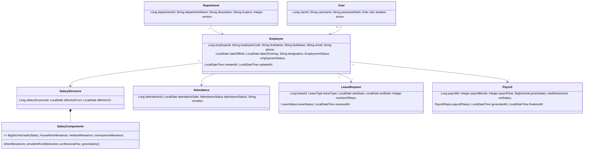
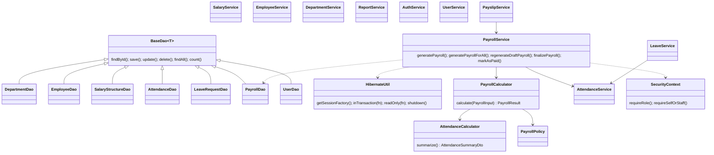

# Class diagram description

## Entities

Enums: `Role {ADMIN, HR, EMPLOYEE}`, `EmploymentStatus {ACTIVE, INACTIVE}`,
`AttendanceStatus {PRESENT, ABSENT, HALF_DAY, PAID_LEAVE, UNPAID_LEAVE}`, `LeaveStatus {PENDING, APPROVED, REJECTED}`,
`LeaveType {ANNUAL, SICK, CASUAL, UNPAID}`, `PayrollStatus {DRAFT, FINALIZED, PAID}`.

## Layers

## Console layer
`Main` → `MainMenu` (sign-in, top menu) → `DepartmentMenu`, `EmployeeMenu`, `SalaryMenu`, `AttendanceMenu`, `LeaveMenu`,
`PayrollMenu`, `PayslipMenu`, `ReportMenu`, `UserMenu`, `SelfServiceMenu` (EMPLOYEE role). Shared helpers:
`ConsoleIO` (validated input, error wrapper), `TableFormatter`, `Views`, `Services` (wiring).

## Exceptions
`PayrollException` (unchecked base) ← `ValidationException`, `BusinessRuleViolationException`, `DuplicateEmployeeException`,
`DuplicateRecordException`, `EmployeeNotFoundException`, `DepartmentNotFoundException`, `ResourceNotFoundException`,
`PayrollAlreadyExistsException`, `InvalidPayrollException`, `InvalidLeaveRequestException`,
`UnauthorizedOperationException`, `AuthenticationFailedException`, `DatabaseOperationException`.
